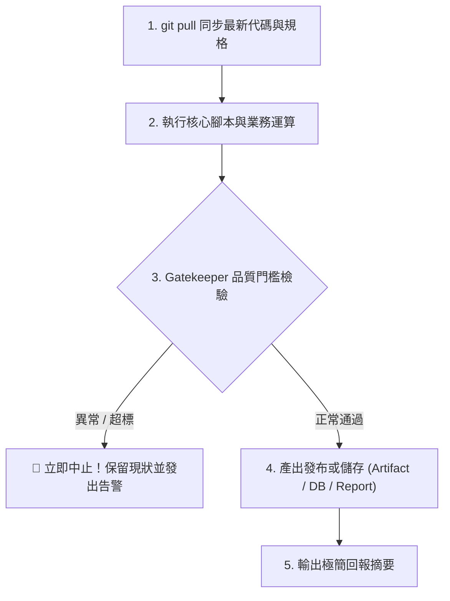

# [工作流名稱] 標準作業程序 (SOP)

本工作流為 `{{PROJECT_NAME}}` 之標準作業程序（SOP），規格收斂於 Git REPO 作為單一真實來源（SSOT）。任何 Agent（Claude Code、Antigravity）或自動化平台均直接指向本文件執行，確保跨介面邏輯完全同步。

---

## 1. 觸發時機與模式

- **流程類型**：`Schedule`（定時排程） / `Task`（標準任務） / `Automation`（事件自動化）
- **觸發時機**：
  - *若為 Schedule*：每個工作日台北時間 09:00。
  - *若為 Task*：使用者口令指定執行、手動維運維護時。
  - *若為 Automation*：收到指定 Webhook 事件或 GitHub Action 觸發時。
- **觸發平台**：Claude 雲端排程 / Antigravity 排程 / GitHub Actions / 本地 CLI。
- **單行呼叫 Prompt（跨平台標準語法）**：

  ```text
  git pull --ff-only origin main，讀取並執行 .claude/workflows/<本檔案名稱>.md，完成後依規格回報。
  ```

---

## 2. 執行前置與安全邊界

- **工作目錄**：REPO 根目錄。
- **環境綁定**：綁定專案虛擬環境（`{{ENV_NAME}}`，Python `{{PYTHON_VERSION}}`）。
- **前置動作**：
  1. `git pull --ff-only origin main`（確保本地與遠端主幹完全同步）。
  2. 檢查必要腳本是否存在（例如 `.claude/skills/...` 或 `scripts/...`）。
- **網路許可網域**（若於雲端沙盒環境執行需配置）：
  - `github.com`
  - `api.example.com`
- **唯讀保護與安全約束**：
  - 嚴禁直接 push 至 `main` 分支。
  - 嚴禁在未經 Gatekeeper 驗證前覆寫正式環境資料。
  - 遵循原子化操作，失敗時自動復原或中止。

---

## 3. 標準執行步驟



### 步驟 1：執行前置準備與環境檢查

在 REPO 根目錄執行：

```bash
# 驗證環境與相依性
python3 -c "import sys; print(f'Runtime Python: {sys.version}')"
```

### 步驟 2：執行核心業務指令

呼叫專案內建之 Skill 或腳本處理核心運算：

```bash
# 範例核心命令（可輸出中間狀態至 /tmp 或指定目錄）
python3 scripts/main_task.py --input data/source.json --output /tmp/result.json --gate
```

### 步驟 3：健康檢查門檻判定（Gatekeeper）

解析輸出結果或檢驗指標，必須滿足以下條件方可繼續進行下一步：

- **失敗容許門檻**：錯誤筆數（`errors`）不得大於 **0**（或指定上限）。
- **資料完整性**：關鍵欄位不得為空，筆數需符合最低預期。
- **依賴服務連線**：所有外部 API 連線必須正常回傳 HTTP 200。

🚨 **異常處置守則**：
> 若未能通過 Gatekeeper 檢驗，**必須立即終止工作流**！嚴禁執行後續的覆寫、發布或寫入動作，並於回報中精確說明失敗的檢查項與錯誤訊息。

### 步驟 4：產出持久化與發布

通過 Gatekeeper 檢驗後，執行最後的結果發布：
- 產出檔案寫入指定目錄或產生 Artifact。
- 若需更新狀態，以原子化方式更新對應資料庫或快照。

---

## 4. 執行回報規範

工作流完成後，請依以下標準格式回報（保持簡短、精確）：

- **成功時回報（極簡一句話）**：
  > ✅ **[工作流名稱] 執行完成**：處理總筆數 `X` 筆，Gatekeeper 檢驗全數通過，產出已更新至 `<目標位置>`。

- **失敗時回報**：
  > ❌ **[工作流名稱] 執行中斷**：Gatekeeper 檢驗失敗（原因：`<具體失敗項與錯誤日誌>`），已中止後續寫入作業。
