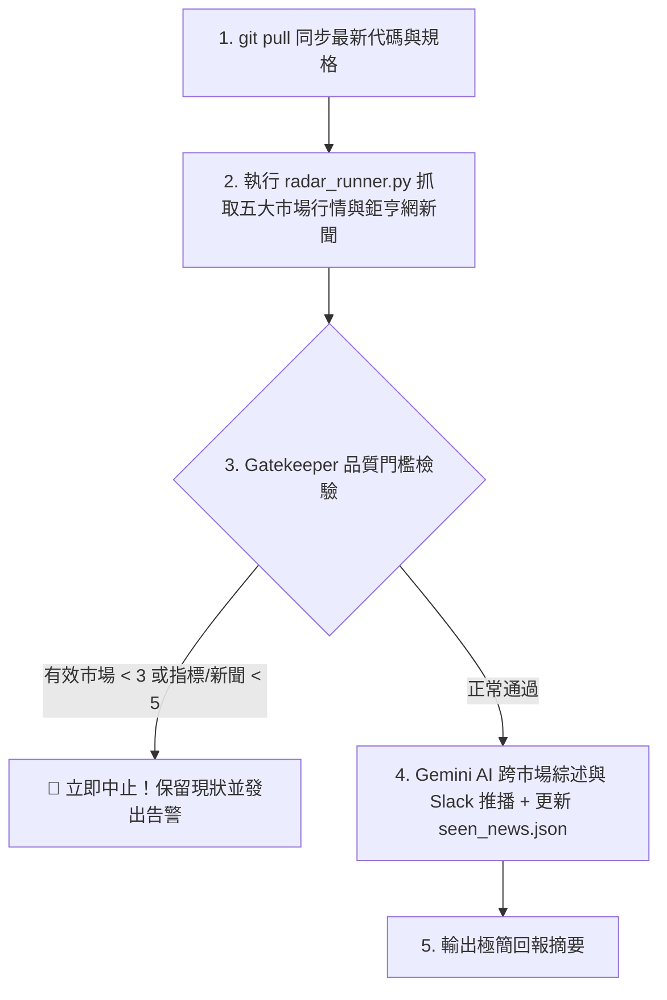

# Market Radar 全球五大市場情報巡檢 標準作業程序 (SOP)

本工作流為 `market-radar` 之標準作業程序（SOP），規格收斂於 Git REPO 作為單一真實來源（SSOT）。任何 Agent（Claude Code、Antigravity）或自動化平台均直接指向本文件執行，確保跨介面邏輯完全同步。

---

## 1. 觸發時機與模式

- **流程類型**：`Schedule`（定時排程） / `Task`（手動觸發）
- **觸發時機**：
  - *Schedule*：每個工作日台北時間 `08:30`、`13:45`、`16:30`、`21:30`。
  - *Task*：使用者口令指定執行或透過 GitHub Actions `workflow_dispatch` 手動觸發。
- **觸發平台**：GitHub Actions / Claude 雲端排程 / Antigravity 排程 / 本地 CLI。
- **單行呼叫 Prompt（跨平台標準語法）**：

  ```text
  git pull --ff-only origin main，讀取並執行 .claude/workflows/market-radar-scan.md，完成後依規格回報。
  ```

---

## 2. 執行前置與安全邊界

- **工作目錄**：REPO 根目錄。
- **環境綁定**：綁定專案虛擬環境（`market-radar`，Python `3.13`）。
- **前置動作**：
  1. `git pull --ff-only origin main`（確保本地與遠端主幹完全同步）。
  2. 檢查必要腳本是否存在（`radar_runner.py`、`market_data_fetcher.py`、`cnyes_news_fetcher.py`、`market_summarizer.py`、`slack_notifier.py`）。
- **網路許可網域**：
  - `github.com`
  - `news.cnyes.com`
  - `news.google.com`
  - `query1.finance.yahoo.com` / `query2.finance.yahoo.com`
  - `generativelanguage.googleapis.com`
  - `hooks.slack.com`

---

## 3. 標準執行步驟



### 步驟 1：執行核心業務指令

```bash
uv run python radar_runner.py
```

（若僅於本地測試驗證、不推播 Slack，可加 `--dry-run`：`uv run python radar_runner.py --dry-run`）

### 步驟 2：健康檢查門檻判定（Gatekeeper）

- **行情完整性**：五大市場（台股/美股/港股/日股/總經）至少 3 個市場正常回傳，且有效報價指標總數 `>= 5`。
- **新聞完整性**：鉅亨網五大板塊至少 3 個板塊正常回傳，且精選新聞總數 `>= 5`。

---

## 4. 執行回報規範

- **成功時回報（極簡一句話）**：
  > ✅ **[Market Radar 全球財經情報巡檢] 執行完成**：採集行情指標 `X` 項、精選新聞 `Y` 則，Gatekeeper 檢驗全數通過，已推播至 Slack。

- **失敗時回報**：
  > ❌ **[Market Radar 全球財經情報巡檢] 執行中斷**：Gatekeeper 檢驗失敗（原因：`<具體失敗項與錯誤日誌>`），已中止後續推播作業。
